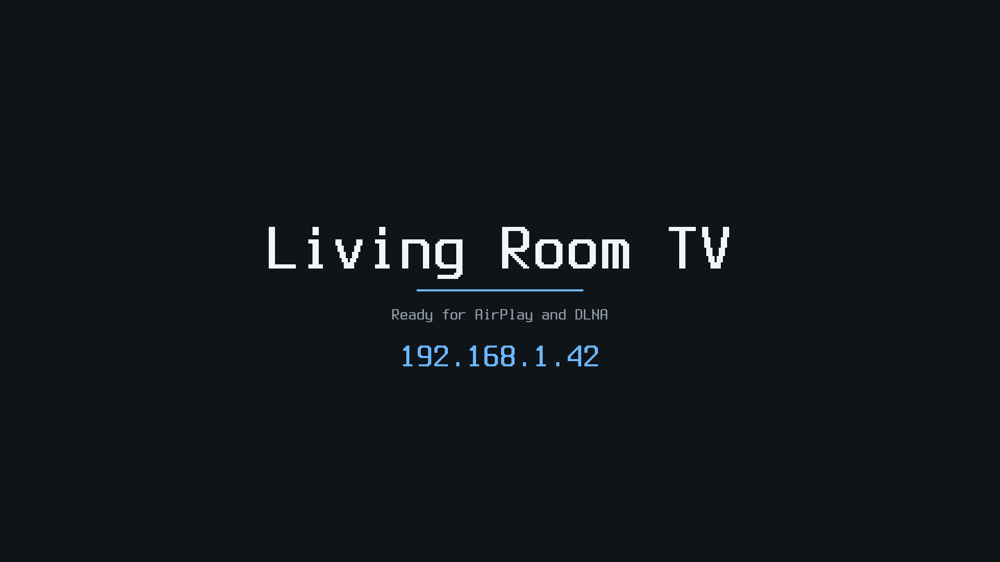

# Cast receiver (CM4, Pi 5)

Raspberry Pi images whose only job is to receive a cast over the network
and play it full-screen on HDMI:

- **AirPlay** screen mirroring and audio from iPhone, iPad and Mac
  ([UxPlay](https://github.com/FDH2/UxPlay) 1.73.7);
- **DLNA/UPnP** media renderer for phone apps, NAS media servers and
  desktop players that "play to" a TV
  ([gmrender-resurrect](https://github.com/hzeller/gmrender-resurrect) 0.3).

When nothing is playing, HDMI shows an idle screen with the receiver's name
and IP address; it comes back when a cast ends.



| Board | Build | H.264 decode | Image |
| --- | --- | --- | --- |
| Compute Module 4 (BCM2711, 4x A72) | [cm4/build.toml](cm4/build.toml) | VideoCore hardware decoder (V4L2), zero-copy to the display | `cm4-cast-receiver-0.1.0.img.xz` |
| Raspberry Pi 5 / Pi 500 (BCM2712, 4x A76) | [pi5/build.toml](pi5/build.toml) | FFmpeg in software on the A76s (the BCM2712 has no H.264 block) | `pi5-cast-receiver-0.1.0.img.xz` |

**Status: written, untested on hardware.** Both images build and their
layout and boot files pass Gaia's checks, but no CM4 or Pi 5 was on hand:
neither has booted. See [What was tested](#what-was-tested).

Google Cast (Chromecast) is not supported: its receiver is proprietary and
needs Google's certificates. Miracast is not included: it needs Wi-Fi P2P
and a WFD stack, and P2P on these boards' CYW4345x under brcmfmac is
unproven.

## Layout

```
cast-receiver/
  external/        Buildroot external tree both boards use (BR2_EXTERNAL_CAST_PATH)
    cast.fragment    the receiver's Buildroot config (packages, init, EROFS)
    cast.txt         the settings file put on the boot partition
    linux/           kernel fragments: cast (shared), cm4, pi5
    package/         uxplay (with its patch), castidle (the idle screen)
    patches/         gmrender-resurrect's patch
    rootfs-overlay/  inittab, fstab, init scripts, the receivers' run scripts
    post-build.sh    trims the target; writes /etc/cast/board.env per board
  cm4/, pi5/       build.toml, defconfig (CPU, kernel, firmware), config.txt, cmdline.txt
```

## How it plays

| Path | CM4 | Pi 5 |
| --- | --- | --- |
| AirPlay video | `h264parse ! v4l2h264dec ! kmssink` | `h264parse ! avdec_h264 ! kmssink` |
| AirPlay audio | AAC-ELD / ALAC: `avdec_aac` / `avdec_alac ! alsasink` (HDMI) | same |
| DLNA | `playbin` (curlhttpsrc, qtdemux/matroskademux/tsdemux, decoder) `! kmssink`, `alsasink` | same; H.264 and HEVC files decoded by FFmpeg |

- **Decoding.** On the CM4, H.264 goes through the VideoCore decoder
  (`bcm2835-codec`, a V4L2 stateful m2m device). Its frames are dmabufs;
  `kmssink` scans them out on a display plane without a copy or a colour
  conversion (UxPlay's `-vc identity -srgb no`). The Pi 5 has no H.264
  block; FFmpeg decodes on the four A76s (1080p60 H.264 is well within
  them), and `kmssink` takes its I420 frames as they are (one copy into a
  scan-out buffer, no conversion). No GPU, Mesa or compositor is involved on
  either board. The board's UxPlay options are in `/etc/cast/board.env`.
- **1080p60.** HDMI is set to 1920x1080@60 (`video=` in `cmdline.txt`), and
  UxPlay asks senders for `1920x1080@60` at up to 60 fps.
- **One display owner at a time.** A KMS client must be DRM master to show
  anything, and the first process to open the device becomes master. Stock
  UxPlay opens `kmssink` at start-up and keeps it, and gmrender-resurrect
  keeps its sinks open after playback, so each would lock the other (and the
  idle screen) out. Both are patched to open their sinks only while playing:
  - `external/package/uxplay/0001-…patch`: mirror pipelines stay in NULL
    until the stream's codec is known;
  - `external/patches/gmrender-resurrect/0001-…patch`: stop, end of stream
    and errors go to NULL instead of READY.
- **Idle screen.** `castidle` (in `external/package/castidle`, ~300 lines of
  C) draws into the KMS driver's fbdev emulation (`/dev/fb0`) with the
  kernel's Terminus 16x32 font. It never opens the DRM device, so it never
  competes for master. When a receiver closes the device the kernel restores
  the fbdev mode and the idle screen is back; while a receiver has it open,
  castidle paints black, so letterbox bars stay black. It redraws when an
  address changes.

## Images

| | CM4 | Pi 5 |
| --- | --- | --- |
| Disk | MBR `0xca570001`: p1 boot FAT 24 MiB, p2 root EROFS | MBR `0xca570005`: same layout |
| Boot | Pi 4 firmware (`start4.elf`), `kernel8.img`, `bcm2711-rpi-cm4.dtb` (and `-4-b`), overlays `vc4-kms-v3d-pi4`, `disable-bt` | EEPROM bootloader (no `start*.elf`), `kernel8.img`, `bcm2712-rpi-5-b.dtb`, `bcm2712d0-rpi-5-b.dtb`, `bcm2712-rpi-500.dtb`, overlays `vc4-kms-v3d-pi5`, `disable-bt-pi5` |
| Kernel | Raspberry Pi 6.12.61, `bcm2711_defconfig` + `linux/cast.fragment` + `linux/cm4.fragment` | Raspberry Pi 6.12.61, `bcm2712_defconfig` with 4 KiB pages (as Buildroot builds it) + `linux/cast.fragment` + `linux/pi5.fragment` |
| Serial console | GPIO14/15 (PL011, `serial0`) | 3-pin debug UART (`ttyAMA10`) |
| CPU profile | `cortex-a72` (`-mcpu=cortex-a72+nocrypto`: the BCM2711 has no crypto extension) | `cortex-a76` |

Both kernels: EROFS built in, no fbcon or logo, no Bluetooth, CAN,
USB media, DVB, netfilter, tunnels, extra filesystems, MTD or ATA. Both
roots: `root=PARTUUID=<signature>-02 rootfstype=erofs ro`, no initramfs,
`/tmp` and `/run` in RAM; nothing is written to the eMMC or SD card at run
time, so pulling power is safe. Init: BusyBox init and mdev; rcS runs
settings (`cast.txt`) → syslogd → mdev (modules) → D-Bus → network →
avahi; init keeps `castidle`, `uxplay` and `gmediarender` running.

Sizes (builds of 2026-11-01):

| | CM4 | Pi 5 |
|---|---|---|
| Root (EROFS, lz4hc) | 30.7 MiB | 31.7 MiB |
| Kernel modules | 864 (12 MiB) | 863 (12 MiB) |
| Boot partition used | 10.7 of 24 MiB | 8.7 of 24 MiB |
| `sdcard.img` | 55.7 MiB | 56.7 MiB |
| `sdcard.img.xz` (`xz -9`) | 32.7 MiB | 32.3 MiB |

The Pi 5 root is 1 MiB larger because it carries FFmpeg's software H.264
and HEVC decoders: that board has no H.264 hardware block.

The largest single item in each root is the kernel's module set. An
allowlist of the modules a board loads would cut most of it, but that list
needs a running board to collect. The CM4's first build had a 33.1 MiB root
with 1,037 modules; trimming more kernel subsystems and keeping only the
board's Wi-Fi firmware took it to 30.7 MiB.

## Configure

Everything is in `cast.txt` on the boot partition (FAT: any computer can
edit it after flashing, or mount `/dev/mmcblk0p1`). Reboot to apply.

| Key | Default | Meaning |
| --- | --- | --- |
| `NAME` | `Cast-<serial>` | The name on HDMI and in the senders' device lists |
| `WIFI_SSID` / `WIFI_PSK` | empty | Join this Wi-Fi network as well (WPA2/WPA3-personal; empty PSK: open network) |
| `WIFI_COUNTRY` | `US` | Wi-Fi regulatory domain |
| `AIRPLAY` / `DLNA` | `1` | Turn a receiver off with `0` |
| `AIRPLAY_PASSWORD` | empty | A password senders must enter |
| `UXPLAY_EXTRA` | empty | More UxPlay options (`uxplay -h`) |
| `DEBUG_SHELL` | `0` | `1`: root shell on the serial console (115200 8N1) |

Ethernet always uses DHCP; it keeps retrying, so a cable plugged in after
boot works. The hostname is `cast-<last 8 digits of the serial>`.

Other knobs in the boot files: `cmdline.txt`'s `video=HDMI-A-1:1920x1080@60`
(the HDMI mode; e.g. `1280x720@60`), and `config.txt`'s `cma-256` (memory
for frames; keep it on 1 GB boards).

## Build

From the Gaia repository root, with `<board>` `cm4` or `pi5`. Keep the
build, outputs and caches off slow disks:

```bash
GAIA_CACHE_DIR=/mnt/nvme-wd/gaia-cache taskset -c 2-31 gaia run examples/boards/cast-receiver/<board>/build.toml \
  --set workspace.build_dir=/mnt/nvme-wd/cast-<board>/build \
  --set outputs.dir=/mnt/nvme-wd/cast-<board>/out \
  --set cache.downloads=/mnt/nvme-wd/cast-dl \
  --set cache.ccache.dir=/mnt/nvme-wd/cast-ccache
```

A cold build takes about an hour on a 32-thread host (`taskset -c 2-31`).
The Buildroot git mirror is kept in the workspace (`<board>/.gaia/cache/git`)
whatever `GAIA_CACHE_DIR` says; symlink `<board>/.gaia/cache` to a fast
disk if the checkout is on a slow one.

Outputs: `<outputs.dir>/images/sdcard.img` (raw) and
`<outputs.dir>/<board>-cast-receiver-0.1.0.img.xz`.

## Flash

### CM4 (eMMC)

A CM4 with eMMC is written over USB. On the CM4 IO board: fit the
`nRPIBOOT` jumper (J2, "disable eMMC boot"), connect the USB-C "USB slave"
port to the computer, then power the board.

**With rpiboot ([usbboot](https://github.com/raspberrypi/usbboot)):**

```bash
sudo rpiboot -d mass-storage-gadget64
```

The eMMC appears as a USB disk (check `lsblk` for its name, here
`/dev/sdX`), then:

```bash
xzcat cm4-cast-receiver-0.1.0.img.xz | sudo dd of=/dev/sdX bs=4M conv=fsync status=progress
```

**With Atlas:** Atlas's USB boot handles the BCM2711 (`0a5c:2711`) and
writes a raw or `.zst` image through the mass-storage path: flash
`sdcard.img` (or recompress the `.img.xz` to `.zst`). Atlas's own flasher
(raze-flasher) is CM5-only; the CM4 uses the mass-storage path.

Remove the jumper and power-cycle: the CM4 boots from eMMC. A CM4 Lite
boots the same image from an SD card on the IO board.

### Pi 5 (SD card)

Write the image to a microSD card (here `/dev/sdX`; check `lsblk`), or with
Raspberry Pi Imager's "Use custom":

```bash
xzcat pi5-cast-receiver-0.1.0.img.xz | sudo dd of=/dev/sdX bs=4M conv=fsync status=progress
```

The Pi 5's bootloader boots the SD card by default. Use the HDMI port next
to the USB-C power input (HDMI0).

### Then

Connect HDMI0 and Ethernet. The idle screen shows the address; the receiver
appears as an AirPlay target in Control Center → Screen Mirroring, and as a
DLNA renderer ("play to") in DLNA apps.

## What was tested

Built and checked on the build host (Fedora 44, x86_64), **not on a board**:

- Both Gaia builds: Buildroot 2026.02.3, all packages, the kernels and the
  assemblies (`image:check` with `pi_model = "cm4"` / `"pi5"`: every overlay
  `config.txt` loads is in the boot tree).
- The patches apply (Buildroot applies them during the build); the built
  UxPlay and gmrender-resurrect carry them.
- The disks: the MBR signature and partitions match `cmdline.txt`'s
  `root=PARTUUID=…-02`; the boot partitions hold the kernel, DTBs and
  overlays (and on the CM4 the firmware); `fsck.erofs` passes on each root,
  which holds the receivers, castidle (aarch64), the overlay's init files
  and the board's `/etc/cast/board.env`.
- `post-build.sh` for each board: the right UxPlay options and only that
  board's Wi-Fi files; an unknown board fails the build.
- castidle: built for the host and rendered at 1920x1080 into a memory
  framebuffer (`idle-screen.png` is that output).
- `S01castconfig` against a `cast.txt` with CRLF line ends, quotes,
  `$`, spaces and an unknown `$(...)` line: values round-trip and nothing is
  executed.

Written, untested on hardware:

- booting either board with these kernels, EROFS root and PARTUUID;
- vc4 fbdev at 1080p60 and the idle screen's handover to and from
  `kmssink` (the restore on DRM close, the black screen while casting);
- CM4: `v4l2h264dec` → `kmssink` zero-copy at 1080p60, and the colour range;
- Pi 5: `avdec_h264` at 1080p60 (CPU load, latency) → `kmssink`;
- HDMI audio through alsa-lib's vc4-hdmi config;
- AirPlay mirroring and audio from iOS/macOS, DLNA playback;
- Wi-Fi (brcmfmac firmware and `cast.txt` settings);
- boot time.

## Not included

- Hardware HEVC: both SoCs have a stateless HEVC decoder (`rpi-hevc-dec`,
  built as a module), but GStreamer reaches it through `gst1-plugins-bad`'s
  v4l2codecs (`v4l2slh265dec`), which Buildroot builds only with udev; these
  images use mdev. AirPlay H.265 mirroring (`UXPLAY_EXTRA=-h265`) would
  therefore decode in software (Pi 5 only; the CM4 image has no software
  video decoder).
- AirPlay video (YouTube-style HLS URLs from iOS apps): needs UxPlay's
  `-hls` and GStreamer's HLS demuxer.
- CM4: video other than H.264 is not shown (no software video decoder).
