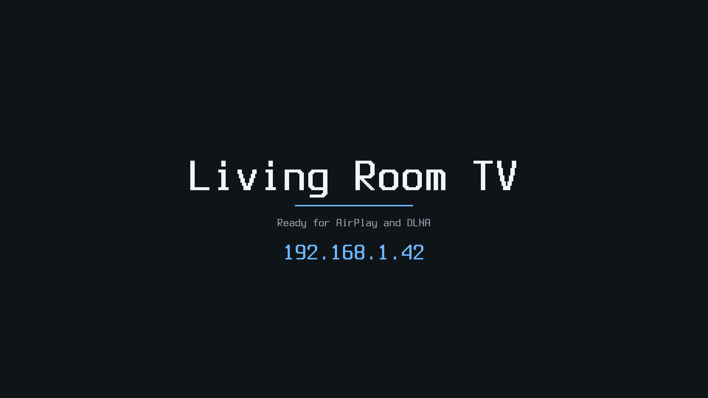

# CM4 cast receiver

A Raspberry Pi Compute Module 4 image whose only job is to receive a cast
over the network and play it full-screen on HDMI:

- **AirPlay** screen mirroring and audio from iPhone, iPad and Mac
  ([UxPlay](https://github.com/FDH2/UxPlay) 1.73.7);
- **DLNA/UPnP** media renderer for phone apps, NAS media servers and
  desktop players that "play to" a TV
  ([gmrender-resurrect](https://github.com/hzeller/gmrender-resurrect) 0.3).

When nothing is playing, HDMI shows an idle screen with the receiver's name
and IP address; it comes back when a cast ends.



**Status: written, untested on hardware.** The image builds and its layout
and boot files pass Gaia's checks, but no CM4 was on hand: it has not booted.
See [What was tested](#what-was-tested).

Google Cast (Chromecast) is not supported: its receiver is proprietary and
needs Google's certificates. Miracast is not included: it needs Wi-Fi P2P
and a WFD stack, and the CM4's CYW43455 P2P support under brcmfmac is
unproven.

## How it plays

| Path | Pipeline |
| --- | --- |
| AirPlay video | `appsrc ! h264parse ! v4l2h264dec ! kmssink` |
| AirPlay audio | AAC-ELD / ALAC: `avdec_aac` / `avdec_alac ! alsasink` (HDMI) |
| DLNA | `playbin` (curlhttpsrc, qtdemux/matroskademux/tsdemux, `v4l2h264dec`, gst-libav audio) `! kmssink`, `alsasink` |

- **Hardware decode.** H.264 goes through the VideoCore decoder
  (`bcm2835-codec`, a V4L2 stateful m2m device, `/dev/video10`). Its frames
  are dmabufs; `kmssink` scans them out on a display plane without a copy or
  a colour conversion (UxPlay's `-vc identity -srgb no`). No GPU, Mesa or
  compositor is involved.
- **1080p60.** HDMI is set to 1920x1080@60 (`video=` in `cmdline.txt`), and
  UxPlay asks senders for `1920x1080@60` at up to 60 fps.
- **One display owner at a time.** A KMS client must be DRM master to show
  anything, and the first process to open the device becomes master. Stock
  UxPlay opens `kmssink` at start-up and keeps it, and gmrender-resurrect
  keeps its sinks open after playback, so each would lock the other (and the
  idle screen) out. Both are patched to open their sinks only while playing:
  - `external/package/uxplay/0001-…patch`: mirror pipelines stay in NULL
    until the stream's codec is known;
  - `external/patches/gmrender-resurrect/0001-…patch`: stop, end of stream
    and errors go to NULL instead of READY.
- **Idle screen.** `castidle` (in `external/package/castidle`, ~300 lines of
  C) draws into the KMS driver's fbdev emulation (`/dev/fb0`) with the
  kernel's Terminus 16x32 font. It never opens the DRM device, so it never
  competes for master. When a receiver closes the device the kernel restores
  the fbdev mode and the idle screen is back; while a receiver has it open,
  castidle paints black, so letterbox bars stay black. It redraws when an
  address changes.

## Image

| | |
| --- | --- |
| Disk | MBR, signature `0xca570001`: p1 boot FAT (24 MiB, 11 MiB used), p2 root (EROFS, lz4hc, read-only) |
| Boot | Pi 4 firmware (`start4.elf`), kernel `kernel8.img`, `bcm2711-rpi-cm4.dtb` (and `bcm2711-rpi-4-b.dtb`), overlays `vc4-kms-v3d-pi4`, `disable-bt` |
| Kernel | Raspberry Pi 6.12.61 (`bcm2711_defconfig` + `assets/linux.fragment`): EROFS built in, no fbcon/logo, no Bluetooth/CAN/USB-media/DVB/netfilter/extra filesystems |
| Root | `root=PARTUUID=ca570001-02 rootfstype=erofs ro`, no initramfs; `/tmp` and `/run` in RAM; nothing is written to the eMMC at run time, so pulling power is safe |
| Init | BusyBox init and mdev; rcS runs settings (`cast.txt`) → syslogd → mdev (modules) → D-Bus → network → avahi; init keeps `castidle`, `uxplay`, `gmediarender` running |
| CPU | Gaia `[cpu] profile = "cortex-a72"` (`BR2_cortex_a72`, `-mcpu=cortex-a72+nocrypto`: the BCM2711 has no crypto extension) |

Sizes (build of 2026-11-01):

| Output | Size |
| --- | --- |
| `sdcard.img` (what gets written) | 55.7 MiB |
| `cm4-cast-receiver-0.1.0.img.xz` | 32.9 MiB |
| root, `rootfs.erofs` | 30.7 MiB (51 MiB unpacked) |
| of which kernel modules | 12 MiB unpacked, 864 modules |
| of which libraries | 30 MiB unpacked (OpenSSL's libcrypto 5.6, libstdc++ 2.3, GLib/GIO 3.5, GStreamer plugins 3.4) |
| boot files | 11 MiB (gzipped kernel 8.2 MiB, `start4.elf` 2.2 MiB) |

The first build's root was 33.1 MiB with 1,037 modules. Trimming more kernel
subsystems (USB network adapters, tunnels, protocols, filesystems, MTD,
ATA, camera sensors) and keeping only the CM4's Wi-Fi firmware took it to
30.7 MiB. The largest remaining item is the kernel's module set. An
allowlist of the modules this board loads would cut most of the 12 MiB,
but that list needs a running CM4 to collect.

## Configure

Everything is in `cast.txt` on the boot partition (FAT: any computer can
edit it after flashing, or mount `/dev/mmcblk0p1`). Reboot to apply.

| Key | Default | Meaning |
| --- | --- | --- |
| `NAME` | `Cast-<serial>` | The name on HDMI and in the senders' device lists |
| `WIFI_SSID` / `WIFI_PSK` | empty | Join this Wi-Fi network as well (WPA2/WPA3-personal; empty PSK: open network) |
| `WIFI_COUNTRY` | `US` | Wi-Fi regulatory domain |
| `AIRPLAY` / `DLNA` | `1` | Turn a receiver off with `0` |
| `AIRPLAY_PASSWORD` | empty | A password senders must enter |
| `UXPLAY_EXTRA` | empty | More UxPlay options (`uxplay -h`), e.g. `-h265` |
| `DEBUG_SHELL` | `0` | `1`: root shell on the serial console (GPIO14/15, 115200 8N1) |

Ethernet always uses DHCP; it keeps retrying, so a cable plugged in after
boot works. The hostname is `cast-<last 8 digits of the serial>`.

Other knobs in the boot files: `cmdline.txt`'s `video=HDMI-A-1:1920x1080@60`
(the HDMI mode; e.g. `1280x720@60`), and `config.txt`'s `cma-256` (memory
for decoded frames; keep it on 1 GB modules).

## Build

From the Gaia repository root. Keep the build, outputs and caches off slow
disks:

```bash
GAIA_CACHE_DIR=/mnt/nvme-wd/gaia-cache taskset -c 2-31 gaia run examples/boards/cm4-cast-receiver/build.toml \
  --set workspace.build_dir=/mnt/nvme-wd/cm4-cast/build \
  --set outputs.dir=/mnt/nvme-wd/cm4-cast/out \
  --set cache.downloads=/mnt/nvme-wd/cm4-cast/dl \
  --set cache.ccache.dir=/mnt/nvme-wd/cm4-cast/ccache
```

The Buildroot git mirror is kept in the workspace (`.gaia/cache/git`
beside this file) whatever `GAIA_CACHE_DIR` says; symlink that directory to
a fast disk if the checkout is on a slow one.

Outputs: `<outputs.dir>/images/sdcard.img` (raw) and
`<outputs.dir>/cm4-cast-receiver-0.1.0.img.xz`.

## Flash (CM4 eMMC)

A CM4 with eMMC is written over USB. On the CM4 IO board: fit the
`nRPIBOOT` jumper (J2, "disable eMMC boot"), connect the USB-C "USB slave"
port to the computer, then power the board.

**With rpiboot ([usbboot](https://github.com/raspberrypi/usbboot)):**

```bash
sudo rpiboot -d mass-storage-gadget64
```

The eMMC appears as a USB disk (check `lsblk` for its name, here
`/dev/sdX`), then:

```bash
xzcat cm4-cast-receiver-0.1.0.img.xz | sudo dd of=/dev/sdX bs=4M conv=fsync status=progress
```

**With Atlas:** Atlas's USB boot handles the BCM2711 (`0a5c:2711`) and
writes a raw or `.zst` image through the mass-storage path: flash
`sdcard.img` (or recompress the `.img.xz` to `.zst`). Atlas's own flasher
(raze-flasher) is CM5-only; the CM4 uses the mass-storage path.

Remove the jumper and power-cycle: the CM4 boots from eMMC. A CM4 Lite
boots the same image from an SD card on the IO board (write it with `dd`
or any SD writer).

Then connect HDMI0 and Ethernet. The idle screen shows the address; the
receiver appears as an AirPlay target in Control Center → Screen Mirroring,
and as a DLNA renderer ("play to") in DLNA apps.

## What was tested

Built and checked on the build host (Fedora 44, x86_64), **not on a CM4**:

- The Gaia build: Buildroot 2026.02.3, all packages, the kernel and the
  assembly (`image:check` with `pi_model = "cm4"`: every overlay
  `config.txt` loads is in the boot tree).
- The patches apply (Buildroot applies them during the build); the built
  UxPlay and gmrender-resurrect carry them.
- The disk: MBR signature `0xca570001` with p1 (FAT, bootable) and p2
  (EROFS), so `root=PARTUUID=ca570001-02` names the root; the boot
  partition holds the firmware, kernel, both DTBs and the three overlays;
  `fsck.erofs` passes on the root and it holds the receivers, castidle
  (aarch64) and the overlay's init files.
- castidle: built for the host and rendered at 1920x1080 into a memory
  framebuffer (`idle-screen.png` is that output).
- `S01castconfig` against a `cast.txt` with CRLF line ends, quotes,
  `$`, spaces and an unknown `$(...)` line: values round-trip and nothing is
  executed.

Written, untested on hardware:

- booting the CM4 from eMMC with this kernel, EROFS root and PARTUUID;
- vc4 fbdev at 1080p60 and the idle screen's handover to and from
  `kmssink` (the restore on DRM close, the black screen while casting);
- `v4l2h264dec` → `kmssink` zero-copy at 1080p60, and the colour range;
- HDMI audio through alsa-lib's vc4-hdmi config;
- AirPlay mirroring and audio from iOS/macOS, DLNA playback;
- Wi-Fi (brcmfmac firmware for the CM4 and `cast.txt` settings);
- boot time.

## Not included

- H.265: AirPlay H.265 mirroring (`UXPLAY_EXTRA=-h265`) and HEVC DLNA files
  need the stateless HEVC decoder (`v4l2slh265dec`), which needs
  `gst1-plugins-bad`'s v4l2codecs and therefore udev; this image uses mdev.
- AirPlay video (YouTube-style HLS URLs from iOS apps): needs UxPlay's
  `-hls` and GStreamer's HLS demuxer.
- Software video decoding: anything not H.264 is not shown.
